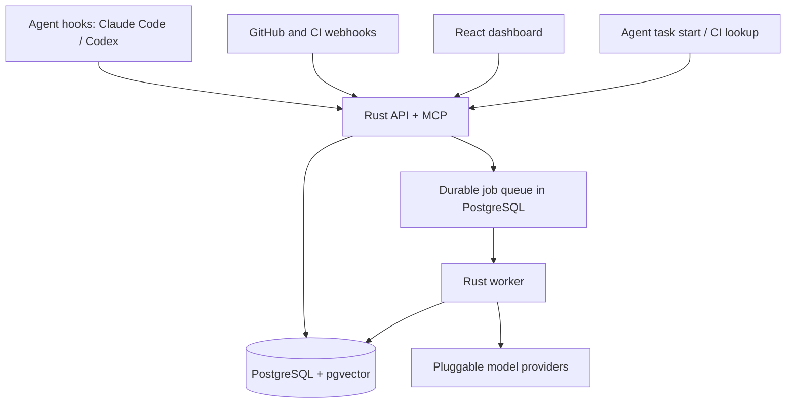

# Architecture

This document describes the system components, repository layout, data model, and runtime workflows. See [`api.md`](api.md) for API contracts and [`security.md`](security.md) for security controls.

## System Diagram



## Components

| Component | Technology | Role |
| --- | --- | --- |
| `antibody-api` | Rust, Axum, Tokio | Serves the HTTP API, MCP (`/mcp`), authentication, authorization, and admin endpoints. Runs SQL migrations on start. |
| `antibody-worker` | Rust, Tokio | Claims jobs from PostgreSQL for extraction, embeddings, Git/CI events, revalidation, and retention sweeps. You can run multiple workers. |
| PostgreSQL 18 + pgvector | PostgreSQL | Stores all data, full-text indexes, vector embeddings, and the job queue. Antibody does not use Redis, a graph database, or an object store. |
| Web UI | React, strict TypeScript, Vite | Builds to static files. Calls only the Rust HTTP API. Does not run a Node.js process at runtime. |
| Caddy | Caddy | Serves the static UI, proxies `/v1/*` and `/mcp*` to the API, and manages TLS certificates when you configure a domain. |

HTTP routes, MCP tools, and workers share the same Rust crates.

## Repository Layout

```text
Cargo.toml, Cargo.lock, rust-toolchain.toml   Rust workspace (toolchain pinned to 1.97.0)
crates/
  antibody-core/          Domain types, state machines, secret redaction, normalization
  antibody-db/            SQLx data access and SQL migrations
  antibody-search/        Exact, full-text, and vector retrieval and ranking
  antibody-integrations/  Webhook parsing, signature verification, and hook payloads
  antibody-providers/     LLM and embedding provider adapters
  antibody-api/           Axum HTTP API and MCP server (binary: antibody-api)
  antibody-worker/        Tokio job worker (binary: antibody-worker)
  antibody-cli/           Agent CLI for hooks and session uploads
apps/web/                 React + strict TypeScript + Vite dashboard (pnpm)
openapi/                  Generated OpenAPI and MCP tool schemas (checked in CI)
integrations/             Copy-ready agent and CI configuration files
deploy/                   Dockerfiles, Caddyfile, Compose files, env.example
docs/                     Architecture, development, API, security, operations, integrations
scripts/smoke.sh          Docker Compose system test
```

## Data Model

Every database row carries an `organization_id`. Every query filters by `organization_id`. The schema is in `crates/antibody-db/migrations/0001_init.sql`.

| Table | Purpose |
| --- | --- |
| `organizations` | Organization settings: `raw_capture_enabled` (default `false`), `raw_retention_days` (default `30`, range `0` to `3650`), `external_providers_approved`, `ci_cross_repository_search`, `webhook_secret_version`. |
| `principals`, `users`, `api_tokens`, `web_sessions` | Identities (`admin` or `member` role, `user` or `service` kind), Argon2id password hashes, SHA-256 token hashes, and browser sessions. |
| `repositories`, `repository_grants`, `components` | Repositories (`github`, `gitlab`, or `generic`), per-principal `read`/`write` grants, and path-glob components for monorepos. |
| `sessions`, `session_payloads` | Session metadata and redacted payloads. Payloads live in a separate table so the worker can delete them on schedule. |
| `source_artifacts` | Commits, pull requests, check runs, workflow runs, deployments, and sessions with their observed state. |
| `solutions`, `solution_sources`, `solution_sessions` | Extracted solutions with versions, fingerprints, signature hashes, applicability rules, and lifecycle fields. |
| `evidence` | Per-solution evidence records with a `trusted` flag. |
| `embeddings` | Vector embeddings keyed by content hash, provider, model, and model version. |
| `retrievals`, `outcomes` | Search records (candidates, latency, context tokens) and reported outcomes. |
| `ci_events`, `webhook_deliveries` | CI failure records and webhook replay-protection records. |
| `workflow_improvements` | Candidate workflow changes observed in agent sessions. |
| `audit_events` | Redacted metadata records of security and administrative actions. |
| `jobs` | The durable PostgreSQL job queue. |

## Flow A: Session Ingestion

1. An agent hook sends `POST /v1/sessions` with a `sessions:write` bearer token and an `Idempotency-Key` header.
2. The API validates the request size, message count, field lengths, repository name, and revision format.
3. The API verifies write access to the repository and redacts recognizable secrets from every string.
4. In one database transaction, the API stores the session row, the redacted payload, a `session` source artifact, and an `extract_session` job.
5. The API returns `202 Accepted` with the ingestion ID. An identical retry returns the same ID with `duplicate: true`. A retry with the same key and a different body returns `409 idempotency_conflict`.
6. The worker loads the payload and processes it as untrusted data:
   - Without an LLM provider (or without `external_providers_approved`), the worker runs the rule-based extractor.
   - With an approved LLM provider, the worker sends the transcript as data, validates the returned JSON, and redacts it again. If the model fails, the worker uses the rule-based extractor.
7. The worker saves the solution through `upsert_extracted`. The fingerprint combines a lineage key (error signatures or title) with an applicability key (dependency constraints and platforms).
   - If another session produces the same fingerprint, it corroborates the existing solution.
   - If the applicability differs, the worker creates a new version in the same lineage.
8. Agent claims that tests passed are saved as untrusted `agent_claim` evidence. They never change the solution state.
9. If the organization uses `structured_only` capture, the worker deletes the raw payload in the same transaction. The worker then queues an `embed_solution` job.
10. If Git or CI events for that revision arrived before the session, the worker links them immediately.

Ingestion status, extraction status (`pending`, `running`, `succeeded`, `failed`, `skipped`), solution verification, and deployment state are separate fields. A `skipped` status means the session did not contain a solved problem.

## Flow B: Retrieval

`POST /v1/context/search`, the MCP `find_relevant_context` tool, and the Claude Code `UserPromptSubmit` hook all call `SearchEngine::search`.

1. **Check access scope:** The engine computes the caller's readable repositories from their role, grants, token allow-list, and repository status (`disconnected` repositories are excluded). If the scope is empty, the search returns no results.
2. **Extract search signals:** The engine extracts normalized error signatures, code symbols, file paths, and query terms from the request.
3. **Run indexed search:** PostgreSQL matches signature hashes, symbol overlap, path overlap, and full-text rank within `ANTIBODY_SEARCH_TIMEOUT_MS` (default `1200` ms). In parallel, the engine embeds the query within `ANTIBODY_EMBED_TIMEOUT_MS` (default `400` ms) and runs vector similarity search (minimum cosine similarity `0.45`). If a stage times out, the response sets `degraded: true` and returns the available results.
4. **Compute base score:** Exact signature adds `1.0`, shared symbols add `0.12` each (up to 3), shared paths add `0.1` each (up to 3), normalized full-text rank adds up to `0.5`, and vector similarity adds `0.8 * (similarity - 0.3)`.
5. **Filter and rerank:** The engine re-fetches candidates with the repository scope filter and multiplies the base score by:
   - Evidence factor (`verified` = `1.0`, `corroborated` = `0.85`, `candidate` = `0.65`, plus `0.03` per trusted evidence item up to 3)
   - Applicability factor
   - Recency factor (`0.8` to `1.0`, decaying over 180 days)
   - Source availability factor (`0.9` if sources were deleted or are unavailable)
6. **Filter incompatible states:** The engine excludes `withdrawn` and `superseded` solutions. It withholds solutions that violate known dependency, component, or platform constraints (counted in `suppressed_incompatible`) unless `include_incompatible` is `true`. Solutions with `needs_revalidation = true` are returned with a warning.
7. **Return suggestions:** The engine returns at most three suggestions. Each suggestion includes the issue, remedy, source links, applicability status, verification summary, and match reasons.
8. **Follow-up actions:** `get_solution` returns full evidence details. `report_outcome` records `used`, `rejected`, or `inapplicable` for a retrieval ID.

Every search response marks retrieved text as untrusted data.

## Flow C: CI Failure Lookup

- **GitHub Webhooks (`POST /v1/webhooks/github`):** Receives `check_run` and `workflow_run` events. On a failed check, the worker creates a `ci_events` row, redacts and truncates the log excerpt, and searches the failing repository (or all active repositories if `ci_cross_repository_search` is enabled).
- **Generic CI Webhooks (`POST /v1/webhooks/ci`):** Runs the same process synchronously and returns matching solutions in the HTTP response. The response always sets `blocking: false` so Antibody never fails a CI build.

## Flow D: Propagation and Invalidation

The `process_git_event` and `revalidate` worker jobs handle repository changes:

- **Merge to default branch:** Marks the fix as merged. This adds corroborating evidence, not verification.
- **Revert commit (`This reverts commit <sha>`):** Sets `merge_state = reverted` and `needs_revalidation = true`, records revert evidence, and writes an audit event.
- **Dependency manifest change:** Flags live solutions that have dependency constraints under the changed directory with `needs_revalidation = true`.
- **Repository deleted or archived:** Sets the repository status to `disconnected` (excluding it from all searches) and marks its sources unavailable.
- **Cross-repository propagation (`GET /v1/solutions/{id}/propagation`):** Lists other repositories or monorepo components in the caller's scope that hit the same error signature. Antibody never modifies code in any repository.

## Solution States

```text
candidate -> corroborated -> verified          (forward transitions)
any live state -> superseded -> withdrawn
any live state -> withdrawn                    (terminal state)
```

- **Live states:** `candidate`, `corroborated`, `verified`.
- **Hidden states:** `superseded`, `withdrawn`. Search never returns solutions in these states.
- **Revalidation flag:** `needs_revalidation` is a separate boolean flag with a reason. A revert, dependency change, or failing check sets this flag. A new passing check or an administrator action clears it.
- **Merge and deployment:** Merge state and deployment state are separate from verification. A merge moves a `candidate` to `corroborated` at most. **Merge and deployment never verify a solution.**
- **What verifies a solution:** A signed webhook check that passes on a revision containing the fix, or an audited administrator `verify` action.
- **Confirmed reuse:** A reported `used` outcome starts as `claimed`. It becomes `ci_verified` only when a signed CI check passes on that revision.

## Job Queue

- **Job types:** `extract_session`, `embed_solution`, `process_git_event`, `ci_lookup`, `revalidate`, `retention_sweep`.
- **Atomic enqueue:** The API enqueues jobs in the same database transaction as the write that triggers them. A unique index on `(kind, dedupe_key)` prevents duplicate active jobs.
- **Worker leases:** Workers claim jobs with `FOR UPDATE SKIP LOCKED`, hold a lease (`ANTIBODY_WORKER_LEASE_SECS`, default `120` s), and send heartbeats while running. If a worker crashes, another worker claims the job after the lease expires.
- **Retries and dead letters:** Failed jobs retry with exponential backoff (5 s base, 30 min maximum, up to 8 attempts). After 8 failed attempts, the worker sets `state = dead`. Administrators can retry dead jobs with `POST /v1/admin/jobs/{id}/retry`.
- **Maintenance:** Every 60 seconds, each worker reclaims expired leases and enqueues a `retention_sweep` job. On startup, the worker enqueues missing embeddings (up to 5,000 solutions).

## Model Providers

Provider adapters implement Rust traits:

- `ANTIBODY_EMBEDDING_PROVIDER`: `none`, `hash` (deterministic local vectors for tests), `openai-compatible`, or the hosted presets `openai` and `gemini`.
- `ANTIBODY_LLM_PROVIDER`: `none`, `openai-compatible`, `anthropic` (native Messages API), or the hosted presets `openai`, `gemini`, and `deepseek`. Presets read `ANTHROPIC_API_KEY`, `OPENAI_API_KEY`, `GEMINI_API_KEY`, or `DEEPSEEK_API_KEY` when `ANTIBODY_*_API_KEY` is unset.

Antibody classifies each provider URL as `local` or `external`. Antibody sends private data to an `external` provider only when an administrator enables `external_providers_approved`.
