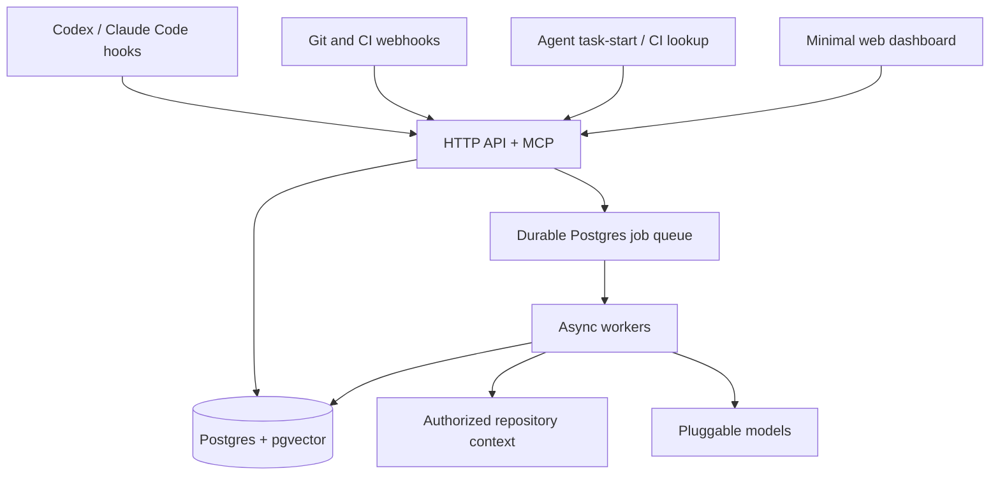

# Antibody — Implementation Specification

Status: Proposed v1 · 2026-10-19

## 1. Goal

Antibody is an open-source, self-hostable collective memory service for coding agents. Its purpose is to prevent engineers and agents from repeatedly investigating issues already solved by teammates. The key success case: Engineer A fixes and verifies an issue; Engineer B, possibly in another repository, finds and reuses that fix before spending time and tokens on the same investigation.

Not in scope: building a coding agent, replacing Git/CI, automatically applying patches, or installing a resident daemon on every developer machine.

## 2. Decisions and scope

- Support multiple organizations, repositories, and components within monorepos.
- No required local daemon. Use agent hooks and Git/CI webhooks. Codex may require a small hook command; Claude Code can use supported HTTP hooks where available. Verify both against current installed client versions during implementation.
- Session-end ingestion through authenticated HTTP; first-prompt retrieval through MCP or HTTP; CI failure retrieval through the same search engine.
- Store authorized raw sessions with retention controls. Asynchronous workers extract structured solutions and generate embeddings.
- PostgreSQL, pgvector, and PostgreSQL full-text search. Do not require Redis, a graph database, or proprietary cloud services.
- Pluggable LLM and embedding providers, including self-hosted models.
- HTTP only for explicitly trusted local networks; HTTPS for remote use.
- Minimal UI for administrators and inspection. Coding agents remain the primary user interface.
- Default retrieval returns at most three concise matches with links and verification status.

## 3. Required implementation stack

These choices are **requirements for v1**, not optional suggestions. Agents must not substitute a Node.js backend.

| Layer | Required technology | Guidance |
|---|---|---|
| API and MCP server | **Rust** | Axum + Tokio, Serde for schemas, Tower middleware, structured tracing; business logic in Rust crates. |
| Background workers | **Rust** | Tokio workers using a PostgreSQL-backed durable jobs table; bounded concurrent work, leases, retries, and idempotency. |
| Data access and migrations | **Rust + PostgreSQL** | SQLx with checked-in SQL migrations and parameterized queries. PostgreSQL is the source of truth. |
| Search | **PostgreSQL + pgvector** | PostgreSQL full-text and exact matching, vector embeddings, and explicit applicability/authorization filters. |
| HTTP/MCP contracts | **Rust-owned schemas** | Keep OpenAPI generated/maintained from Rust endpoint types, and publish MCP tool JSON schemas. CI detects contract drift. |
| Web frontend | **TypeScript + React + Vite** | Strict TypeScript, responsive accessible UI, static production build; no Node.js server required at runtime. |
| Frontend API client | **Generated TypeScript types** | Generate types/client from the Rust API's OpenAPI contract. Avoid duplicated hand-written request/response models. |
| Packaging | **Cargo + pnpm or npm** | Cargo workspace for all Rust services/crates; a separate web package with a committed JS lockfile. No requirement for Nx or Magnetic dependencies. |
| Deployment | **Docker Compose** | Rust API, Rust worker, PostgreSQL with pgvector, and a static web server (e.g., nginx/Caddy). Reverse proxy enforces HTTPS for remote traffic. |

Implementation requirements:

- Use an explicit Rust toolchain pin (`rust-toolchain.toml`) and commit `Cargo.lock`. Pin the frontend runtime/package manager and commit its lockfile.
- Keep provider adapters behind Rust traits. Ship a no-external-provider mode with working ingestion and exact/full-text retrieval; semantic search becomes available once an embedding provider is configured.
- Treat transcripts, model output, and retrieved source text as untrusted data. Never execute commands derived from them.
- Reuse the same Rust domain services from HTTP routes, MCP tools, and workers. Do not create a separate Node/TypeScript API implementation.
- Implement MCP protocol semantics in Rust using a maintained library or a conformance-tested adapter; do not presume an unverified crate/version is supported.
- Build the web app into static assets. It calls only the Rust HTTP API; the browser never connects directly to PostgreSQL or to model providers.
- Keep backend unit/integration tests in Cargo; use Vitest/React Testing Library for web components and Playwright for browser end-to-end flows.

## 4. Architecture



Deploy four containers: Rust API/MCP, Rust worker, TypeScript-built static web UI, and PostgreSQL. A PostgreSQL-backed job queue is sufficient for v1. Keep ingestion, retrieval, and authorization domain logic shared between HTTP, MCP, and workers. Optional object storage can be added later for large transcripts.

Suggested standalone repository layout:

```text
antibody/
  Cargo.toml               # Rust workspace
  Cargo.lock
  rust-toolchain.toml
  crates/
    antibody-api/          # Rust Axum HTTP routes, auth, MCP transport
    antibody-worker/       # Rust Tokio extraction/indexing jobs
    antibody-core/         # Rust domain types, state transitions, policy
    antibody-db/           # Rust SQLx data access + migrations
    antibody-search/       # Rust exact, full-text, vector, applicability
    antibody-integrations/ # Rust webhook parsing and provider contracts
    antibody-providers/    # Rust LLM/embedding provider adapters
  apps/web/                # React + TypeScript + Vite dashboard
    src/api/               # generated OpenAPI client/types
    src/routes/            # Overview, Repositories, Knowledge, Activity, Settings
    src/components/
    package.json
    tsconfig.json
    vite.config.ts
  deploy/compose.yaml
  deploy/env.example
  docs/api.md
  docs/security.md
  docs/integrations/
  tests/                    # cross-service integration and smoke fixtures
  README.md
  LICENSE
  spec.md
```

**Use Rust for all backend services, React/TypeScript for the frontend, and PostgreSQL for persistence.** License: Apache-2.0 with DCO sign-off (see section 16). Do not directly import private Magnetic product code into the new repository.

## 5. Core data model

| Record | Fields / responsibilities |
|---|---|
| Organization | id, settings, retention policy |
| Principal | id, organization, roles, token scope, revocation |
| Repository | id, organization, provider ID, URL, permissions, default branch |
| Component | repository, path/glob, package identity |
| Session | agent type, external ID, repository, revision, raw payload reference, status, retention expiry |
| SourceArtifact | commit, PR, issue, check, URL, revision, observed state |
| Solution | symptom, root cause, remedy, applicability, owner, state, source references |
| Evidence | solution, tested revision, test/check, environment, result, source |
| Embedding | content hash, provider/model/version, vector |
| WorkflowImprovement | target scope, proposed change, version, evaluation, owner, lifecycle |
| Retrieval | caller, task fingerprint, candidates, latency, context tokens |
| Outcome | retrieval, candidate, used/rejected/inapplicable, verified result |
| AuditEvent | actor, action, resource, timestamp, redacted metadata |
| Job | type, dedupe key, lease, attempts, state, next run |

All data is scoped to an organization. Repository access is checked **before** search, ranking, and source expansion. Solution states: `candidate`, `corroborated`, `verified`, `superseded`, `withdrawn`. Preserve a separate `needs_revalidation` applicability flag. A merged change is not automatically verified or deployed. An agent claim that tests passed is not verification.

## 6. Flow A: session ingestion

1. A session-end hook sends an authenticated `POST /v1/sessions` with an idempotency key, agent type, repository, revision if known, and permitted session payload.
2. API checks identity, repository access, schema, size, and capture policy; rejects unsafe payloads and redacts recognizable secrets before storage.
3. In one durable transaction, store session metadata/payload and enqueue extraction. Return `202 Accepted` and ingestion ID. Identical retries return the existing ID; conflicting key reuse fails.
4. Worker treats transcript as untrusted input. Extract errors, symptoms, attempted solutions, relevant files/symbols, proposed fixes, and workflow observations.
5. Correlate with Git commits, merges, tests, and CI evidence. Without evidence, the solution stays `candidate`.
6. Deduplicate against existing solutions while preserving distinct versions and applicability conditions.
7. Generate embeddings and full-text index records. Record processing failures for retries without undoing successful ingestion.
8. Record audit events and model versions. Never put transcripts or credentials in logs.

Raw transcript retention defaults to 30 days, configurable down to zero with structured-only capture. Raw capture requires explicit organization configuration. Document that redaction is best-effort. Deletion must cover raw and derived content, embeddings, and pending jobs.

## 7. Flow B: first-prompt retrieval

1. Agent task-start integration calls MCP `find_relevant_context` or HTTP `POST /v1/context/search` with task description, repository, revision, and optional error/component context.
2. Authorize caller and determine accessible repositories.
3. Search exact error signatures, symbols, paths, source IDs, full-text index, and optionally embeddings.
4. Rerank for component/dependency applicability, evidence quality, version, recency, and source availability.
5. Return up to three concise suggestions: issue, reuse action, source links, applicability conditions, verification state, and reason for match.
6. `get_solution` returns expanded evidence. Agent may reuse, adapt, or reject; Antibody never silently applies a patch.
7. `report_outcome` records used/rejected/inapplicable and optional check evidence.

Target indexed retrieval p95 <= 1.5 seconds under pilot load without LLM inference; time out promptly and fail open. MCP availability alone does not guarantee first-prompt invocation. Prove invocation for each supported agent integration; label instruction-based fallback as best effort.

## 8. Flow C: CI failure lookup

Receive signed Git/CI event with repository, revision, failing check, normalized signature, and permitted excerpt. Search through the same authorized retrieval engine. Return prior solutions and diagnostics without making CI blocking by default. Deduplicate repeated events by repository, revision, check, and signature.

## 9. Flow D: propagation and invalidation

On merge, revert, dependency update, source deletion, or permission change, enqueue targeted revalidation. Identify sibling components that may benefit from a verified fix. Never apply cross-repository changes automatically. Suppress withdrawn fixes and clearly qualify stale evidence. Workflow improvements progress through `candidate -> evaluated -> available -> promoted -> retired`. Promotion requires owner approval, reproducible evaluation, negative cases, and preservation of checks.

## 10. API contracts

| Interface | Operation | Purpose |
|---|---|---|
| HTTP | `POST /v1/sessions` | Idempotent asynchronous session ingestion |
| HTTP | `GET /v1/sessions/{id}` | Authorized processing status |
| HTTP | `POST /v1/webhooks/github` | Signed Git and CI events |
| HTTP | `POST /v1/context/search` | Authorized hybrid search |
| HTTP | `GET /v1/solutions/{id}` | Solution and evidence |
| HTTP | `POST /v1/outcomes` | Record recommendation outcome |
| HTTP | `GET /v1/repositories` | Connected repositories |
| HTTP | `GET /v1/health/live` | Liveness |
| HTTP | `GET /v1/health/ready` | Dependency readiness |
| MCP | `find_relevant_context` | Search before investigation |
| MCP | `get_solution` | Fetch detailed evidence |
| MCP | `report_outcome` | Record feedback |

Publish OpenAPI and MCP schemas, typed error codes, request size limits, idempotency rules, and auth requirements. MCP and HTTP must share retrieval and permission logic. No arbitrary shell, code writing, secret management, or automatic publishing tools.

## 11. Minimal web UI

The v1 UI **is included**. It is for system inspection and administration, not agent chat.

- **Overview:** repositories, ingestions, processing failures, solutions, retrievals, confirmed reuse.
- **Repositories:** connections, permissions, components, event freshness.
- **Knowledge:** searchable solutions, applicability, source links, verification, supersede/withdraw.
- **Activity:** session processing, queue failures, CI events, retrieval outcomes.
- **Settings:** tokens, model providers, retention, deletion/export, audit records.

**Frontend implementation instructions (mandatory):**

- Use **React with strict TypeScript and Vite**. Produce static files for a small web-serving container; do not introduce an SSR runtime for v1.
- Build a typed client from the Rust OpenAPI schema. The UI must not duplicate domain state machines or authorization decisions; the Rust API is authoritative.
- Use route-level loading, empty, forbidden, stale, and error states. Accessible keyboard navigation, semantic controls, and visible focus are required.
- Use an admin login flow backed by Rust sessions with secure, HttpOnly cookies in same-origin deployments. Add CSRF protection to mutating requests, appropriate Origin checks, and avoid browser-stored long-lived API tokens.
- Keep views small and task-focused. A solution detail view must display symptom, applicability, confidence/verification state, source links, tests, and withdraw/supersede actions when authorized.
- Make raw transcript access a separate privileged action with audit logging. Never render untrusted Markdown/HTML without sanitization.
- Use Vitest + React Testing Library for component behavior and Playwright for the primary user path and authorization/error states.
- Follow the minimal Magnetic paper-like design language only as inspiration where licensing permits; do not import private Magnetic UI code into this open-source repository.

Do not build a workflow canvas, marketplace, individual engineer leaderboard, or embedded IDE in v1.

## 12. Security and reliability

- Deny unauthorized cross-repository and cross-organization access, including search result counts and derived embeddings.
- Verify webhook signatures against raw request bytes and reject replayed deliveries.
- Scope and revoke tokens; store hashes, not plaintext credentials. Apply rate limits.
- Enforce request-size limits, sanitize logs, and never execute transcript instructions or repository text.
- Require explicit administrator approval before sending private content to external model providers.
- Provide export, deletion, configurable retention, audit events, and a documented secret-leak response.
- Use durable job leases, bounded retries, exponential backoff, dead-letter state, and atomic enqueue.
- Separate ingestion success, extraction success, verification, and deployment state.
- Track ingestion errors, queue age, extraction failures, search latency, false positives, and confirmed reuse.
- Provide Compose deployment, migration/backup/restore instructions, and a safe local example.

## 13. Acceptance criteria

| ID | Requirement | Verification |
|---|---|---|
| A01 | Fresh self-hosted install works without proprietary accounts | Compose smoke test |
| A02 | Session ingestion is durable and idempotent | Retry and crash tests |
| A03 | Invalid/unauthorized/oversized payloads fail safely | Negative API tests |
| A04 | Extracted knowledge retains source references | Worker fixture tests |
| A05 | Merge is distinct from verification and deployment | State transition tests |
| A06 | Supported task-start hook actually invokes retrieval | Real agent integration test |
| A07 | Known exact error finds prior verified fix | Search integration test |
| A08 | Similar but incompatible fix is rejected or qualified | Negative applicability test |
| A09 | Authorized cross-repo retrieval works; unauthorized retrieval leaks nothing | Isolation tests |
| A10 | CI failure finds prior diagnosis | Signed webhook integration test |
| A11 | Reverts and stale dependencies invalidate applicability | Invalidation tests |
| A12 | UI shows solutions, ingestion, evidence, and failures | Browser E2E tests |
| A13 | Retention/deletion removes raw and derived data | Retention tests |
| A14 | Missing model provider does not break ingestion | Degraded-mode tests |
| A15 | Outcome tracking never fabricates savings | Metrics tests |
| A16 | HTTP API, MCP, search, extraction, and jobs run in Rust without Node backend | Cargo build, integration tests, Compose process inspection |
| A17 | Web UI is React + strict TypeScript, statically served with typed API client | `tsc --noEmit`, Vite production build, contract drift check |
| A18 | Rust OpenAPI and generated TypeScript client remain compatible | Contract-generation CI and browser API tests |

## 14. Delegation plan

**Phase 0 — foundation:** initialize the pinned Cargo workspace, Rust crates, SQLx migrations, PostgreSQL/pgvector Compose, React/TypeScript/Vite frontend, generated client pipeline, auth, and isolation tests (A01, A03, A09, A16–A18).

**Phase 1 — ingestion (Rust):** Axum sessions API, hook integrations, GitHub webhooks, SQLx-backed durable queue, retention, audit (A02, A03, A13, A14).

**Phase 2 — knowledge extraction (Rust):** Tokio worker, Rust provider traits, evidence correlation, deduplication, solution states, embeddings (A04, A05).

**Phase 3 — retrieval (Rust):** SQLx-based exact/full-text/vector search, applicability ranking, Axum HTTP and Rust MCP, task-start integration (A06–A09).

**Phase 4 — CI and freshness (Rust):** CI failure search, revert/dependency invalidation, workflow candidates (A10–A11).

**Phase 5 — TypeScript UI and pilot:** implement the five React dashboard routes against generated Rust API types, browser E2E tests, documentation, observability, deployment hardening, two-to-three repository pilot (A12, A15, A17–A18).

Delegate independent phases only after shared schemas and contracts stabilize. Parallel agents may own UI, provider adapters, and integration fixtures, but one integration owner must review interfaces and run combined tests. Each agent returns changed paths, test commands/results, remaining risks, and acceptance IDs. Do not describe untested code as verified. No commits, pushes, publication, or production mutations without explicit authorization.

## 15. Pilot and measures

Pilot with 2–3 repositories and approximately 20 engineers. Engineer A merges a verified fix; Engineer B encounters a related problem and retrieves the solution at task start or CI failure. Record whether the fix was applicable, used, and verified. Compare human investigation time, review effort, false positives, and total tokens **including retrieval overhead** against a baseline. Avoid claiming savings from mere search hits or generated summaries.

## 16. Open decisions before public release

Decided (2026-10-20):

- **License and contributor policy:** Apache-2.0 with the Developer Certificate of Origin (sign-off on every commit, checked in CI); no CLA. See `CONTRIBUTING.md`, `CODE_OF_CONDUCT.md`, and `SECURITY.md` (private reporting through GitHub security advisories).
- **Browser authentication:** keep the local bootstrap administrator (`ANTIBODY_BOOTSTRAP_*`) with username/password sessions for now. OIDC is deferred.
- **Git provider scope:** GitHub first (GitHub webhooks plus the generic signed CI webhook). GitLab and others are deferred.
- **Hosted model providers:** Anthropic (native Messages API, LLM only), OpenAI and Gemini (LLM and embeddings), and DeepSeek (LLM only) are supported as presets, alongside any OpenAI-compatible self-hosted server. All hosted providers are external and need administrator approval.

Still open:

- Verify current Codex/Claude Code hook semantics and supported payloads with real clients (Claude Code hook invocation proven; model use of the injected context and Codex trusted-hook run still pending; see `docs/acceptance.md` A06).
- Select the first local model/provider configurations and benchmark them on realistic session fixtures.
- Name a Code of Conduct contact.

These decisions should not block a local implementation spike. Record assumptions and keep provider-specific behavior behind adapters.
